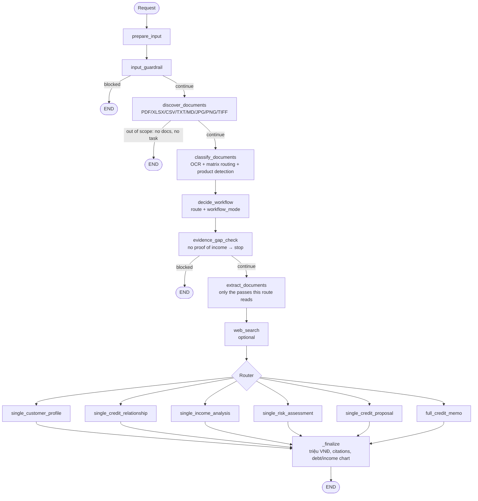

# Retail Credit Memo — Multi-Agent Underwriting

A **multi-agent** system for **retail (individual borrower, khách hàng cá nhân)** credit
underwriting, built on **LangGraph**. It ingests a borrower's dossier — ID and residence
papers, labour contract, payslips, bank statements, PIT returns, the loan application,
house/car purchase contracts, collateral papers, CIC reports, the bank's appraisal report —
then runs OCR → document classification → structured extraction → deterministic
affordability and loan-sizing calculations → specialist agents, and composes a complete
**Credit Memo (tờ trình thẩm định)**, with guardrails along the way.

This is the retail adaptation from SME Creditmemo Multi Agent that applied successfully for POC before.

The entry point is the notebook [local_underwriting_agents.ipynb](local_underwriting_agents.ipynb);
all agent logic lives in the importable package [src/](src/).

---

## Table of Contents

- [Key Features](#key-features)
- [Retail Loan Products and Policy](#retail-loan-products-and-policy)
- [Agent Processing Workflow](#agent-processing-workflow)
- [The Deterministic Calculators](#the-deterministic-calculators)
- [Project Structure](#project-structure)
- [Installation](#installation)
- [Configuration (.env)](#configuration-env)
- [Running It](#running-it)
- [Outputs](#outputs)
- [Checks](#checks)

---

## Key Features

- **Deterministic underwriting pipeline** via LangGraph: every step is a node, and routing is
  decided by explicit rules (the LLM is not free to jump between steps).
- **In-house OCR** for scanned PDFs **and phone photos** (CCCD, sổ đỏ, payslips): `pypdfium2`
  + Tesseract with preprocessing, EXIF rotation and caching.
- **Automatic document classification** against a retail document matrix (22 types),
  rule-based keyword scoring with an LLM fallback when confidence is low.
- **5 specialist agents** + **1 composer**: Customer Profile, Income & Repayment Capacity,
  Credit Relationship, Loan Proposal, Risk Assessment → Credit Memo.
- **Arithmetic in code, not in prompts.** Recognised income, existing obligations, the new
  instalment, **DSR**, surplus after living costs, **LTV** and the **maximum loan** (with the
  limit that binds) are computed deterministically; every figure carries its source.
- **Evidence hierarchy**: money credited on a bank statement beats a payslip, which beats a
  contract figure, which beats the borrower's own declaration.
- **Undisclosed-debt detection**: recurring repayments on bank statements and CIC balances are
  compared with the debts the borrower declared.
- **Configurable product policy** (DSR cap, LTV, tenor, age at maturity, own contribution,
  living-cost floors) per product in one YAML file.
- **Multi-layer guardrails**: input check and evidence-gap check (no proof of income → the
  memo is not attempted).
- **Web search enrichment** (optional, via Tavily) and **LangSmith tracing** (optional).

---

## Retail Loan Products and Policy

Name the product anywhere in the request — *"Lập tờ trình cho khách hàng vay mua nhà"* — and
it is detected by exact alias matching (no LLM):

| Product id | Product | Example aliases |
|---|---|---|
| `TIEU_DUNG` | Vay tiêu dùng tín chấp | tín chấp, vay tiêu dùng, personal loan |
| `MUA_NHA` | Vay mua nhà / bất động sản | mua nhà, mua căn hộ, xây sửa nhà, mortgage |
| `MUA_O_TO` | Vay mua ô tô | mua ô tô, mua xe, auto loan |
| `HO_KINH_DOANH` | Vay hộ kinh doanh | hộ kinh doanh, tiểu thương |

The product does two things:

1. **Document relevance** — it selects the column of
   [src/matrix/document_matrix.yaml](src/matrix/document_matrix.yaml) that marks each document
   **R** (required) or **O** (optional) for each agent. A land-use-right certificate is core
   evidence for a mortgage and supporting for an unsecured loan.
2. **Policy limits** — it selects the limits in
   [src/policy/retail_products.yaml](src/policy/retail_products.yaml): max DSR, max LTV,
   minimum own contribution, max tenor, max age at maturity, product cap, minimum income.

If the request names no product, the calculators use the product implied by the loan
application's purpose (and say so); failing that, the **strictest** limits across all
products. Document relevance falls back to the strongest level across products, so a
document can only be over-prioritised, never dropped.

> ⚠️ **The policy values shipped in `retail_products.yaml` are placeholders**, not a
> regulation and not any bank's policy. Replace them with your institution's current credit
> policy before relying on the output.

---

## Agent Processing Workflow



### Document classification

Each file is OCR'd (PDF pages and image files alike) and scored against the keywords of the
22 document types in the matrix — filename hits count triple. Six groups:

| Group | Types |
|---|---|
| I. Hồ sơ nhân thân | CCCD/hộ chiếu, xác nhận cư trú (CT07), giấy tờ hôn nhân |
| II. Hồ sơ chứng minh thu nhập | HĐLĐ, xác nhận lương/bảng lương, sao kê tài khoản, thuế TNCN, hợp đồng cho thuê, hồ sơ hộ kinh doanh, tài sản/thu nhập khác |
| III. Hồ sơ phương án vay vốn | giấy đề nghị vay vốn, HĐ mua bán nhà đất, HĐ mua bán xe, chứng từ mục đích khác |
| IV. Hồ sơ tài sản bảo đảm | sổ đỏ/sổ hồng, đăng ký xe, chứng thư định giá, TSBĐ khác |
| V. Hồ sơ nội bộ | CIC khách hàng vay, CIC tài sản bảo đảm, CIC người đồng vay |
| VI. Hồ sơ soạn thảo nội bộ | báo cáo thẩm định / xác minh thực tế |

Below the confidence threshold (default 0.65) an LLM classifier picks from the same catalogue,
unless every plausible type routes to the same agents or the filename names exactly one type.
Unmatched documents are shared with every agent, so a miss never hides evidence.

### Structured extraction

| Pass | Documents | Read by |
|---|---|---|
| Income | HĐLĐ, xác nhận lương, sao kê, thuế TNCN, HĐ cho thuê, HKD, thu nhập khác | Income analysis (JSON); affordability table |
| Proposal | Giấy đề nghị vay vốn | Income, credit proposal, risk (JSON); both tables |
| CIC S10A | CIC khách hàng vay (incl. credit cards) | Credit relationship, risk (JSON); affordability table; chart |
| CIC R21 | CIC tài sản bảo đảm | Credit relationship, risk |
| Sitevisit | Báo cáo thẩm định | All five agents; tables (fallback income / collateral value) |

Only the passes a route actually reads are run, and only after the evidence-gap check passed.
Every pass reads money **exactly as printed** plus the unit the page states, and converts to
đồng in code — the model never does unit arithmetic. The appraisal officer's own verdict is
kept in a separate `conclusion` block, labelled as opinion.

### The `full_credit_memo` branch

```
        ┌──────────────────────── run IN PARALLEL ─────────────────────────┐
        │  CustomerProfile   CreditRelationship   IncomeAnalysis           │
        │  (who, where,      (CIC, cards, T24)    (income, obligations,    │
        │   stability)                             DSR, surplus)            │
        │                    CreditProposal                                │
        │                    (max loan, structure, collateral, conditions) │
        └───────────────────────────────┬──────────────────────────────────┘
                                        ▼
                      RISK_ASSESSMENT (receives all four analyses)
                                        ▼
                CREDIT_MEMO_COMPOSER → Tờ trình thẩm định tín dụng KHCN
```

The memo: **1. Tóm tắt khoản vay · 2. Thông tin khách hàng · 3. Quan hệ tín dụng ·
4. Thu nhập và khả năng trả nợ · 5. Đề xuất khoản vay · 6. Đánh giá rủi ro**, all money in
**triệu VNĐ**, footnoted to the source file and page.

---

## The Deterministic Calculators

### Repayment capacity — `[BẢNG TÍNH KHẢ NĂNG TRẢ NỢ]`
[src/agents/affordability_calculator.py](src/agents/affordability_calculator.py)

| Step | Rule |
|---|---|
| Income per source and month | Strongest evidence wins: sao kê > xác nhận lương / sổ HKD > thuế TNCN > hợp đồng > kê khai. Equal rank → lower figure. |
| Recognised income | Average of the last N months (default 6) × recognition share per source (salary 100%, rental 80%, business 70%, other 50% — policy). |
| Living costs | max(declared, policy floor per adult and per dependant). |
| Existing obligations | **max**(declared, recurring debits on statements, CIC-implied) + assumed card payment (5% of limit) when CIC shows a card not declared. |
| New instalment | Largest payment of the schedule: declining balance (default), annuity, or interest-only for bullet. Stress rate when no rate is given. |
| Ratios | DSR, surplus after living costs and debt service, total debt / annual income, age at maturity — each checked against the product policy. |

Warnings are raised for contract-only income, unstable months, declared income far above
evidenced income, undisclosed repayments, a negative surplus, and every policy breach.

### Maximum loan — `[BẢNG TÍNH SỐ TIỀN VAY TỐI ĐA]`
[src/agents/loan_sizing_calculator.py](src/agents/loan_sizing_calculator.py)

The tenor is first capped by product and by age at maturity; then the maximum loan is the
**minimum** of: capacity under the DSR cap, LTV × collateral value, purchase price × (1 −
minimum own contribution), product cap / income multiple, and the amount requested. The table
names the **binding limit** and shows the instalment, DSR and LTV at that amount.

---

## Project Structure

```
.
├── local_underwriting_agents.ipynb   # Entry point — driver notebook
├── src/
│   ├── config.py                     # LLM factory + Config (+ shared rate limiter)
│   ├── types.py                      # Shared types
│   ├── agents/
│   │   ├── supervisor.py             # LangGraph orchestrator
│   │   ├── document_classification.py
│   │   ├── specialist.py             # 5 specialists + memo composer
│   │   ├── income_extraction.py      # proof of income → JSON
│   │   ├── proposal_extraction.py    # loan application → JSON
│   │   ├── cic_s10a_extraction.py    # CIC credit report → JSON
│   │   ├── cic_r21_extraction.py     # CIC collateral report → JSON
│   │   ├── sitevisit_extraction.py   # appraisal report → JSON
│   │   ├── affordability_calculator.py
│   │   ├── loan_sizing_calculator.py
│   │   ├── prompt_blocks.py          # structured blocks + debt/income chart
│   │   ├── guardrails.py, tools.py, tracing.py
│   ├── matrix/document_matrix.yaml   # document type → agents (R/O per product)
│   ├── policy/retail_products.yaml   # product limits (placeholders — set your policy)
│   ├── utils/                        # OCR, extractors, formatting (đồng → triệu VNĐ), charts, diagrams…
│   └── templates/                    # *-structure.md (layout) + *-guidance.md (rules) per agent
├── testing/run_checks.py, testing/checks/
├── docs/ARCHITECTURE.md
├── .env.example
└── README.md
```

> **Note:** `testing/samples/` (customer data) and `logs/` are excluded from git via
> [.gitignore](.gitignore). `.env` holds real API keys — **never commit it**.

---

## Installation

**System requirements:** Python 3.11+ and **Tesseract OCR** with Vietnamese data.

```bash
# macOS
brew install tesseract tesseract-lang

# Ubuntu/Debian
sudo apt-get install tesseract-ocr tesseract-ocr-vie
```

```bash
pip install -r requirements.txt
```

### Notebook outputs — run this once per clone

```bash
nbstripout --install --attributes .gitattributes
```

Running the notebook against real files leaves the customer's names, ID numbers and income in
the notebook's output cells. The `nbstripout` git filter removes outputs from what gets
**committed** while leaving them on screen. `.gitattributes` is in the repository, but the
filter itself lives in `.git/config`, which is not — **without the command above, git commits
the notebook unchanged**. Verify with:

```bash
git add local_underwriting_agents.ipynb
git show :local_underwriting_agents.ipynb | grep -c '"output_type"'   # must print 0
```

---

## Configuration (.env)

Copy `.env.example` → `.env` and fill in the values.

**Per-role models** (required — a missing one causes `you must provide a model parameter`):

```env
MODEL_DECISION=gpt-4o-mini            # route/workflow decision
MODEL_DOCUMENT=gpt-4o-mini            # document classification (LLM fallback)
MODEL_ANALYZER=gpt-4o-mini            # specialist agents
MODEL_CREDIT_MEMO=gpt-4o-mini         # memo composition
MODEL_GUARDRAIL=gpt-4o-mini           # input/output safety guardrail
MODEL_INCOME_EXTRACTION=gpt-4o-mini   # proof-of-income extraction
MODEL_ECONOMY=gpt-4o-mini             # application, CIC and appraisal extractions
```

**API & endpoint:** `OPENAI_API_KEY`, `OPENAI_API_BASE` (any OpenAI-compatible endpoint).

**Feature toggles** (off by default): `RUN_SAFETY_GUARDRAILS`, `RUN_WEB_SEARCH` (needs
`TAVILY_API_KEY`).

**Performance & OCR:**

```env
LLM_REQUESTS_PER_MINUTE=9      # hard ceiling shared by every LLM client
LLM_CLIENT_MAX_RETRIES=3
LLM_MAX_CONCURRENCY=3          # specialists run in parallel in full_credit_memo
OCR_LANG=vie+eng  OCR_DPI=...  OCR_MAX_WORKERS=  OCR_AUTO_ROTATE=0
TESSERACT_CMD=/usr/bin/tesseract   # optional; defaults to Homebrew or PATH
```

All LLM clients share **one** rate limiter, so `LLM_REQUESTS_PER_MINUTE` is a whole-process
ceiling — set it **below** your provider's quota. A full memo costs 6 agent calls plus one
extraction per income document, application, CIC report and appraisal report (a typical
retail file: 12–15 calls). Each run reports its own numbers under `result["rate_limit"]`.

**Name documents clearly** — `Sao ke luong 01-06.2026.pdf` or `CCCD.jpg` settles on the keyword
pass, while `scan001.pdf` may cost a classification call.

**Tracing (optional):** `LANGSMITH_TRACING`, `LANGSMITH_API_KEY`, `LANGSMITH_PROJECT`.

---

## Running It

1. Open [local_underwriting_agents.ipynb](local_underwriting_agents.ipynb).
2. **Cell 2** — loads `.env`, prints `Project root`.
3. **Cell 3** — configure the request:
   ```python
   USER_PROMPT = "Lập tờ trình thẩm định cho khách hàng này. Sản phẩm vay mua nhà"
   INPUT_PATHS = [str(PROJECT_ROOT / "testing" / "samples" / "case_1")]  # file or folder
   ```
4. Run the cells in order; the final cell builds `Supervisor(config)`, draws the graph, runs
   `supervisor.process(...)`, prints the memo, the detected product, the computed
   repayment-capacity headline and every extraction failure.

Other requests: *"Phân tích thu nhập và khả năng trả nợ"*, *"Khách hàng được vay tối đa bao
nhiêu?"*, *"Kiểm tra lịch sử tín dụng CIC"*, *"Đánh giá rủi ro tín dụng"*.

---

## Outputs

Each run creates `logs/<testcase>_<timestamp>/`:

| File | Content |
|---|---|
| `final_response.md` / `.pdf` | The memo (PDF via WeasyPrint, diagrams and charts rendered) |
| `result.json` | Full state (response, route, steps…) |
| `affordability.json` | Repayment-capacity table as data (money in đồng) |
| `loan_sizing.json` | Maximum-loan table as data, with the binding limit |
| `agent_outputs.json` | Raw output of each agent |
| `document_classifications.json`, `document_selections.json` | Classification and per-agent routing |
| `income_extraction.json`, `proposal_extraction.json`, `cic_*_extraction.json`, `sitevisit_extraction.json` | Structured extractions |

---

## Checks

```bash
python testing/run_checks.py          # all
python testing/run_checks.py afford   # only scripts matching "afford"
```

Each script is standalone and tied to a property the pipeline depends on: the calculators'
arithmetic and conservatism (`verify_affordability`), matrix/policy/routing consistency
(`verify_routing`), retail document classification (`verify_filename_decisive`), unit handling
(`verify_units`), templates that survive the prompt engine (`verify_guidance_examples`), the
debt/income chart (`verify_debt_chart_gate`), and a prompt baseline for refactors
(`verify_prompt_unchanged`). Scripts needing data that is not in the repo are reported as
skipped, not failed.
