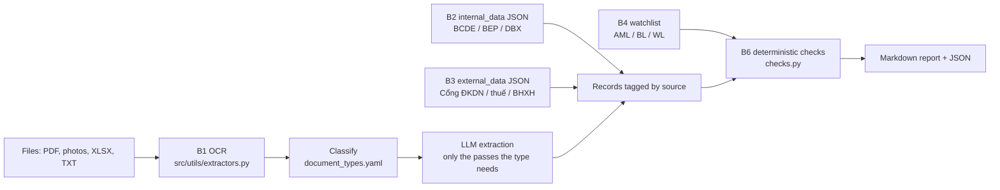

# corp_income — Corporate legal-information agent (BRD items 1–4)

`CORP_INCOME_AGENT` reads a **corporate (KHDN)** dossier, OCRs the papers, extracts the
facts the BRD *Corp Income Assessment* asks for under use case **"Pháp lý doanh nghiệp"**,
and runs the BRD's B6 cross-checks in code:

| BRD item | Sub-component | Output |
|---|---|---|
| 1 | Thông tin cơ bản về pháp lý doanh nghiệp | Legal profile by template; is the company active per tax data; warnings where sources disagree |
| 2 | Cổ đông, thành viên góp vốn | Member/shareholder table (name, %, capital, date acquired); relationships; warning when the individual borrower received capital within 12 months |
| 3 | Người đại diện pháp luật | Legal representative(s) vs actual operator; warning when the representative changed within 12 months. *Leadership capability assessment is out of scope — removed per the BRD dependency note.* |
| 4 | Nợ thuế, BHXH, phạt hành chính, tranh chấp | Tax/social-insurance debts, penalties, enforcement, inspections, disputes and remediation status |

It is **standalone**: it lives in `src/agents/corp_income/` and does not change the retail
supervisor graph or `src/matrix/document_matrix.yaml`, so retail routing is untouched.

## Pipeline (BRD steps B1–B6)



Each record carries its **source** — `customer` (KH cung cấp), `field` (báo cáo thực địa /
AI Site Visit / RBO), `external` (Cổng ĐKDN, cơ quan thuế, BHXH), `internal` (TCB systems).
When sources disagree the summary shows the value in the order
external > customer > field > internal, and the finding lists every source.

## Files

| File | Role |
|---|---|
| `document_types.yaml` | 14 corporate document types: keywords, source, which passes run. Edit here to add a type. |
| `documents.py` | Keyword classifier (filename ×3), `type_overrides` support |
| `prompts.py` | One extraction prompt + JSON schema per BRD item |
| `extraction.py` | Runs the passes, scales money to đồng from `source_unit` |
| `checks.py` | All B6 checks (dates, matching, sums, 12-month windows, watchlist) |
| `report.py` | Fills the report template (`src/templates/corp-income-structure.md`) |
| `agent.py` | `CorpIncomeAgent.run(...)` orchestration |
| `__main__.py` | Command line |

## What the checks do

**Item 1** — MST must match *exactly* across sources (alert); company name, head-office
address, founding date, charter capital and legal representative compared (warning on
mismatch); operating status from the register (alert unless `dang_hoat_dong`, warning if
never looked up); every registration change dated within 12 months of the loan date;
internal data compared with GCN/external (warning "nội bộ chưa cập nhật"); site visit
confirms real operation at the address (alert if not); company on the watchlist (alert).

**Item 2** — ownership % sums to 100 and contributed capital to the charter capital;
member lists compared across sources; transfers within 12 months; the individual
borrower's stake and acquisition date (**alert** if received within 12 months, per BRD);
corporate shareholders flagged for multi-layer ownership review; relationships and
beneficial-owner notes from the site visit; members on the watchlist.

**Item 3** — current representative(s) compared across sources; appointment/removal or a
`legal_rep` registration change within 12 months (**alert**, per BRD); actual operator
(from the site visit / RBO interview) vs legal representative; people met.

**Item 4** — open tax and BHXH debts (alert, with total and > 90-day overdue count) and
conflicts with clearance confirmations; penalties not remediated; enforcement (alert);
disputes (alert when they touch operations, collateral or cash flow); environment/PCCC
risks seen on site.

Severity: 🔴 `alert` · 🟠 `warning` · 🔵 `info` · 🟢 `ok`.

## Usage

```python
from dotenv import load_dotenv
from src.agents.corp_income import CorpIncomeAgent
from src.config import build_llm

load_dotenv()
agent = CorpIncomeAgent(llm=build_llm("MODEL_CORP_INCOME_EXTRACTION", temperature=0.0))
result = agent.run(
    ["testing/samples/khdn_abc/"],          # files or folders
    loan_date="13/10/2026",                # 12-month windows end here
    borrower_names=["Nguyễn Văn A"],       # individual borrower(s) of this loan
    internal_data={"legal_basic": {...}},  # optional, same JSON shape as the pass
    external_data={"legal_basic": {...}},  # optional, e.g. from a Cổng ĐKDN API
    watchlist=[{"name": "...", "tax_code": "...", "list": "AML"}],
    type_overrides={"scan01.pdf": "gcn_dkdn"},
)
result.save("logs/corp_income")            # corp_income_report.md + corp_income_result.json
print(result.items[1]["conclusion"])
```

Through the supervisor (same entry point as the retail agents):

```python
result = sup.process(
    "Kiểm tra pháp lý doanh nghiệp",          # any CORP_INCOME_ROUTE_KEYWORDS phrase
    ["/Workspace/.../khdn_abc/"],
    corp_income_options={                      # optional, passed to CorpIncomeAgent.run
        "loan_date": "13/10/2026",
        "borrower_names": ["Nguyễn Văn A"],
    },
)
result["response"]      # Markdown report
result["corp_income"]   # full structured result (documents, records, findings per item)
```

The request is recognised right after file discovery and goes straight to the
`single_corp_income` node: the retail classifier, evidence-gap check, extraction passes
and memo finalisation are skipped. Trigger phrases (accent-insensitive) are in
`CORP_INCOME_ROUTE_KEYWORDS` in `supervisor.py` — e.g. "pháp lý doanh nghiệp", "KHDN",
"corp income", "thành viên góp vốn", "người đại diện theo pháp luật". Bare "nợ thuế" or
"cổ đông" do not trigger it, so a retail question about taxes stays on the retail route.

Command line:

```bash
python -m src.agents.corp_income testing/samples/khdn_abc --loan-date 13/10/2026 \
    --borrower "Nguyễn Văn A" --external external.json --watchlist watchlist.json
```

Set `MODEL_CORP_INCOME_EXTRACTION` in `.env`. Cost: one LLM call per (document, pass) —
a GCN ĐKDN runs 3 passes, a tax notice 1, a site-visit report 4.

`internal_data` / `external_data` use the pass names as keys (`legal_basic`,
`shareholders`, `legal_rep`, `liabilities`) and the same JSON shape the prompts in
`prompts.py` return; amounts follow their own `source_unit` (default đồng).

## Report template

The report layout is the Markdown file **`src/templates/corp-income-structure.md`**, next
to the retail agents' templates. Replace it with your own layout; no Python change needed.

- Write a placeholder as a name in double curly braces, e.g. `{{tax_code}}`. The agent
  fills it from the extraction and the checks. The template only decides layout and
  wording, so every figure still comes from a document.
- `<!-- ... -->` notes in the template are removed from the report.
- An unknown name renders as `—` and is listed in `result.meta["unknown_placeholders"]`
  (and in the supervisor's step log), so a typo is visible.
- Delete the file to fall back to the built-in layout (`report.DEFAULT_TEMPLATE`), or pass
  `CorpIncomeAgent(template_path=...)` to use a file elsewhere.
- There is no `corp-income-guidance.md`: no LLM writes this report, so there is nothing for
  analysis rules to steer.

| Group | Placeholders |
|---|---|
| General | `as_of`, `borrowers`, `summary_table`, `documents_table`, `scope_note` |
| Item 1 — blocks | `item1_title`, `item1_table`, `item1_findings`, `item1_conclusion` |
| Item 1 — single fields (each also has `<name>_source`) | `company_name`, `company_name_foreign`, `abbreviation`, `tax_code`, `legal_form`, `establishment_date`, `registration_change_number`, `latest_change_date`, `charter_capital`, `head_office_address`, `legal_representatives`, `operating_status` |
| Item 2 | `item2_title`, `members_table`, `borrower_ownership`, `item2_findings`, `item2_conclusion` |
| Item 3 | `item3_title`, `legal_rep_table`, `actual_operator`, `item3_findings`, `item3_conclusion` |
| Item 4 | `item4_title`, `tax_debts_table`, `social_insurance_debts_table`, `administrative_penalties_table`, `enforcement_actions_table`, `disputes_table`, `item4_findings`, `item4_conclusion` |

`*_table` placeholders render a whole Markdown table; `*_findings` render the 🔴/🟠/🔵/🟢
list with evidence; `*_conclusion` is one line.

Check a template before running it:

```python
from pathlib import Path
from src.agents.corp_income.report import unknown_placeholders
print(unknown_placeholders(Path("src/templates/corp-income-structure.md").read_text()))  # [] = all good
```

If your template needs a field that is not in the list (a new BRD field), add it to the
prompt schema in `prompts.py` and one line in `build_context` in `report.py`.

## Known limits (POC)

- **Web search is not done by the agent** (BRD item 1 dependency: "Ở POC chưa thực hiện
  được websearch"). Save the masothue.com / Cổng ĐKDN / bocaodientu.com.vn page as PDF or
  text and add it to the dossier — it is classified as `tra_cuu_dkdn` and treated as an
  external source — or pass the API result as `external_data`.
- **Fraud detection** (tampered documents) is out of scope; AML/BL/WL is only a match
  against the `watchlist` you pass in.
- Its report is not merged into the retail credit memo; the corporate route returns it
  on its own.

## Test

```bash
python testing/checks/verify_corp_income.py    # or: python testing/run_checks.py corp
```

Runs the whole agent with fake LLM chains: classification, pass routing, unit scaling and
every check above.
